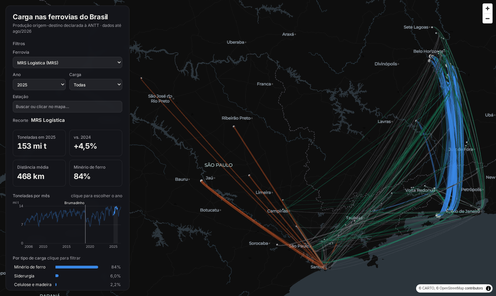
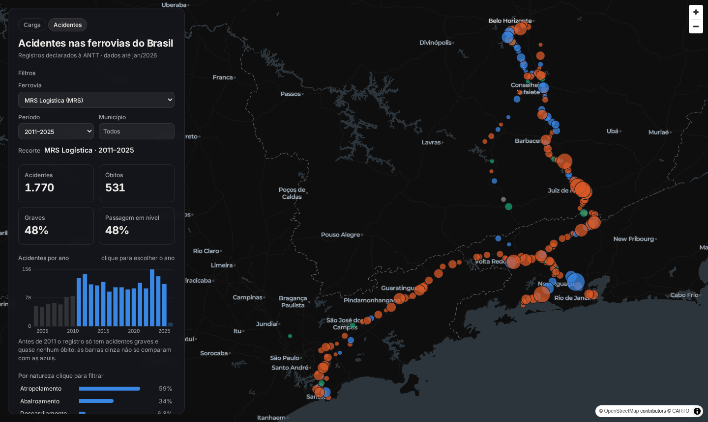

# Carga nas Ferrovias do Brasil

Pipeline ELT que coleta a **produção ferroviária por origem e destino** e os **acidentes ferroviários** que as concessionárias declaram à ANTT. Ele localiza cada estação no mapa, transforma os dados com dbt e publica um **painel de fluxos** e um **painel de acidentes** no GitHub Pages. O foco é a **MRS Logística**.

**🚆 Carga:** https://luissfellipe.github.io/ferrovias-br/ · **⚠️ Acidentes:** https://luissfellipe.github.io/ferrovias-br/seguranca.html · **📚 Documentação do dbt:** https://luissfellipe.github.io/ferrovias-br/dbt/



**Perguntas:** o que as ferrovias transportam, de onde para onde, e como isso mudou em 20 anos? Onde e como acontecem os acidentes, e quem eles atingem?

Projeto independente, feito com dados públicos e sem vínculo com a MRS ou com a ANTT.

## Arquitetura

```
ANTT, SIADE (CKAN, 21 CSVs anuais) ─► ingest_producao.py ─┐
InfraSA, pátios ferroviários (ArcGIS) ─► ingest_patios.py ─┤
Comex Stat, exportação (API) ─────────► ingest_comex.py ───┤
OpenStreetMap, linha em Juiz de Fora ─► ingest_osm_jf.py ──┤
ANTT, RAAF (CKAN, acidentes) ─────────► ingest_acidentes.py ┴─► PostGIS (raw) ─► dbt ─► export_*.py ─► painel estático
                                                                       staging            JSON           MapLibre + deck.gl
                                                                       intermediate                      (GitHub Pages)
                                                                       marts ─► notebooks de análise
                   GitHub Actions: toda semana, do zero, com testes antes de publicar
```

| Camada | Objeto | Descrição |
|---|---|---|
| raw | `raw.producao` | Uma linha do CSV da ANTT por registro, com o texto como veio |
| raw | `raw.patios` | 2.110 pátios declarados pelas concessionárias, com coordenada |
| raw | `raw.arquivos_carregados` | Cada CSV e a data de modificação dele no CKAN |
| raw | `raw.comex_exportacao` | Exportação mensal por UF do produto, porto (URF) e posição SH4 |
| raw | `raw.acidentes`, `raw.indice_acidentes` | Acidentes como vieram, sem a coluna com o nome do maquinista, e o índice oficial |
| raw | `raw.acidentes_arquivos` | O arquivo vigente de cada série, o período que ele declara e o formato de data detectado |
| raw | `raw.osm_jf` | Linha principal da MRS em Juiz de Fora, ruas que a cruzam e passagens em nível, de uma cópia fixa do OpenStreetMap |
| staging | `stg_antt__producao`, `stg_infrasa__patios` | Data, número no padrão brasileiro e nome de estação normalizado |
| staging | `stg_antt__acidentes`, `stg_antt__indice_acidentes` | Data no formato de cada arquivo e natureza dos dois layouts na mesma lista |
| staging | `stg_osm__linha_jf`, `stg_osm__travessias_jf` | O traçado em metros (SIRGAS 2000 / UTM 23S), começando no sul, e onde ruas o cruzam em nível |
| intermediate | `int_producao__deduplicada` | Sem as repetições idênticas publicadas pela ANTT |
| intermediate | `int_estacoes__geolocalizadas` | Cada estação do SIADE com o pátio correspondente |
| intermediate | `int_acidentes__deduplicados`, `int_acidentes__geolocalizados` | Sem os registros repetidos, e com o pátio da estação anterior ao acidente |
| intermediate | `int_estacoes__km_linha_jf`, `int_acidentes__na_linha_jf` | O km de cada estação em JF deduzido dos acidentes, e cada acidente posto no traçado pelo km |
| marts | `dim_estacoes`, `dim_ferrovias`, `dim_mercadorias` | Estação com coordenada, concessionária e mercadoria com grupo |
| marts | `fct_producao_mensal` | Um fluxo por mês, ferrovia, mercadoria, origem e destino |
| marts | `fct_fluxos_anuais`, `fct_ferrovia_grupo_mensal` | Agregados que o painel e os notebooks leem |
| marts | `fct_porto_produto_mensal`, `fct_porto_produto_uf_anual` | Exportação por porto e produto contra o que chegou de trem ao porto |
| marts | `fct_acidentes`, `fct_acidentes_ferrovia_anual` | Um acidente por linha, e acidentes, óbitos e graves por bilhão de TKU por ferrovia e ano |
| marts | `fct_acidentes_na_linha_jf` | Acidentes em Juiz de Fora com o ponto no traçado e o trecho de 1 km |

## O que os dados mostram

| | 2006 | 2018 | 2019 | 2025 |
|---|---|---|---|---|
| MRS, toneladas úteis | 102,0 mi | 136,6 mi | **106,0 mi** | **153,2 mi** |

- **Brumadinho derrubou a MRS em 22% em 2019.** Depois de 25/01/2019, a estação de Córrego do Feijão não embarca mais nada. Mas ela perdeu 7,6 mi t entre fevereiro e dezembro, e **Otávio Dapieve perdeu 33,5 mi t** no mesmo período. A queda foi muito maior que a mina que rompeu. A MRS só voltou ao nível de 2018 em 2023 e bateu o recorde da série em 2025.
- **A carga se mudou de terminal.** O Guaíba era o principal destino do minério em 2006, com 45,4 mi t. Caiu para 20,4 mi t em 2019 e recebeu 31,6 mi t em 2025. A Baía de Sepetiba foi de 22,4 para 57,4 mi t, e o Porto Sudeste, que começa em 2017, chegou a 17,3 mi t.
- **A dependência do minério não mudou.** A carga geral cresceu 40% entre 2006 e 2024, mas o minério cresceu junto, e a fatia dele ficou entre 80% e 87% durante os 20 anos. Fora do minério, o que mais cresceu foi açúcar (que começa em 2007), celulose e madeira, e grãos.
- **A MRS é a 2ª ferrovia do país em tonelagem** (153,2 mi t em 2025, atrás da Carajás, com 177,7 mi t), com distância média de 468 km por tonelada. A Carajás tem 907 km e a Rumo Malha Norte, 1.487 km.

A análise completa está em [`analises/02_mrs.ipynb`](analises/02_mrs.ipynb), e a investigação da fonte em [`analises/01_reconhecimento.ipynb`](analises/01_reconhecimento.ipynb).

## Carga para Santos fora do trilho: perguntas de negócio

**Para quem:** a área comercial e de planejamento de uma ferrovia que chega a Santos.

**Como:** para açúcar, soja, farelo de soja, milho e celulose, o pipeline compara o que o Porto de Santos exportou (Comex Stat) com o que chegou de trem às estações a até 30 km do porto (SIADE, de qualquer concessionária). A diferença é a carga que chegou por outro meio, que para esses produtos em Santos é, na prática, caminhão. A análise completa, com gráficos, está em [`analises/03_carga_fora_do_trilho.ipynb`](analises/03_carga_fora_do_trilho.ipynb).

**1. Quanto das exportações por Santos chega de trem?**
Em 2025, das 92,4 mi t exportadas nesses cinco produtos, 61,4 mi t chegaram de trem (66%) e **31,0 mi t chegaram por fora do trilho**. Quase tudo está em dois produtos: soja (12,6 mi t) e açúcar (11,6 mi t). No açúcar, só 51% chega de trem.

| produto (2025) | exportado | de trem | fora do trilho | % de trem |
|---|---|---|---|---|
| Soja | 34,6 mi t | 21,9 mi t | 12,6 mi t | 63% |
| Açúcar | 23,5 mi t | 11,9 mi t | 11,6 mi t | 51% |
| Milho | 14,7 mi t | 11,9 mi t | 2,8 mi t | 81% |
| Farelo de soja | 10,0 mi t | 7,4 mi t | 2,6 mi t | 74% |
| Celulose | 9,7 mi t | 8,3 mi t | 1,4 mi t | 86% |

**2. A fatia do trem está crescendo?**
Sim, mas não o bastante para diminuir a carga fora do trilho. De 2015 a 2025, a exportação por Santos cresceu 80% (51,2 → 92,4 mi t) e o trem cresceu 111% (29,1 → 61,4 mi t), passando de 57% para 66% do total. Mesmo assim, o que chega por fora do trilho subiu de 22,0 para 31,0 mi t, com pico de 36,2 mi t em 2023. A celulose foi de 67% para 86% de trem; o açúcar ficou entre 46% e 59% nos 11 anos, sem tendência.

**3. A carga escapa o ano todo ou só no pico da safra?**
Depende do produto, e essa diferença decide o que fazer:
- **Grãos: falta capacidade no pico.** O trem entrega de 2,8 a 3,8 mi t de grãos por mês de fevereiro a dezembro, enquanto a exportação vai de 2,4 mi t (janeiro) a 6,3 mi t (março). O trilho fica plano e o excesso da safra vai de caminhão. Em julho, o trem troca soja (0,8 mi t) por milho (1,7 mi t) sem aumentar o total. O melhor mês do trem foi de 1,8 mi t em 2015 para 4,2 mi t em 2025, e o pico da exportação foi de 4,2 para 7,1 mi t: a capacidade cresce, mas o pico cresce junto.
- **Açúcar: não é capacidade.** A parcela do trem fica perto de 50% na safra e fora dela, e cai para 34% a 37% em fevereiro e março, na entressafra. O caminho para o açúcar é comercial: preço, terminais e acesso das usinas ao trilho.

**4. De onde vem a carga que vai fora do trilho?**
Em 2025, os maiores volumes são: açúcar de São Paulo (7,9 mi t: 17,1 exportadas e 9,1 de trem), soja de Goiás (6,3 mi t) e soja de Mato Grosso (4,2 mi t). É aproximado: no Comex Stat a UF é a de produção, e no SIADE é a da estação onde a carga embarcou. Soja de Goiás que vai de caminhão até um terminal em Minas conta como exportação de GO e trilho de MG. No açúcar de São Paulo, produção e embarque ficam no mesmo estado, e a distorção é pequena.

**5. Quem leva até Santos a carga que vai de trem?**
Em 2025, a MRS responde por **24% do açúcar** e **40% da celulose** que chegam de trem, e por 6% da soja e 7% do milho. A Rumo Malha Norte lidera em grãos e celulose, e a FCA no açúcar (47%). A coluna `ferrovia` do SIADE é a concessionária responsável pelo fluxo, não quem opera cada trecho.

**6. Quanto isso representa?**
As 31,0 mi t fora do trilho são cerca de **840 mil viagens de caminhão por ano**, considerando 37 t por viagem, a carga de um bitrem graneleiro (uma suposição, não um dado). Pela distância média que o trem já percorre até Santos em cada produto, seriam cerca de **33 bilhões de TKU**; a MRS inteira produziu 71,7 bilhões em 2025. É um teto, não uma previsão: parte dessa carga vem de perto do porto, onde o caminhão é mais competitivo.

## Segurança: onde e como acontecem os acidentes da MRS



**Para quem:** a área de segurança operacional e de relação com as comunidades de uma ferrovia que atravessa cidades.

**Como:** os acidentes que as concessionárias declaram à ANTT (RAAF, 2004 a jan/2026), com o ponto do pátio da estação anterior ao acidente, contra a carga do SIADE dos mesmos meses. A análise completa está em [`analises/04_seguranca.ipynb`](analises/04_seguranca.ipynb).

**1. Dá para comparar um ano com outro?** Só a partir de 2011. De 2004 a 2009, todo registro é grave e o país inteiro soma 1 óbito em seis anos, com 127 a 189 atropelamentos por ano: os acidentes não graves e as mortes não eram registrados. Em 2011 são 1.028 registros e 117 óbitos. Quem olhar a contagem desde 2004 vai ver os acidentes "triplicarem", e o que mudou foi o registro.

**2. Como a MRS se compara?** De 2011 a 2025, a MRS tem 0,91 acidente grave por bilhão de TKU. A EFVM, com o mesmo TKU no período (930 bilhões), tem 0,19: a MRS registra 4,7 vezes mais acidentes graves (844 contra 180). Em mortes, **a MRS é a primeira do país: 531 óbitos**, contra 317 na Rumo Malha Sul e 260 na Rumo Malha Paulista.

**3. Que tipo de acidente mata?** Atropelamento: **59% dos acidentes e 92% dos óbitos** (490 de 531). Os descarrilamentos foram 111 em 15 anos, **sem nenhuma morte**. O problema de segurança da MRS não está no trilho, e sim na faixa de domínio dentro das cidades.

**4. Onde?** **Juiz de Fora concentra 104 óbitos de 2011 a 2025, ou 19,6% das mortes da MRS**, em 221 acidentes. O segundo município, Três Rios, tem 22. Dentro de JF, o trecho urbano do Posto km 271 até Benfica (passando por Juiz de Fora, Mariano Procópio e Francisco Bernardino) soma 126 acidentes e **74 dos 104 óbitos**. Não há tendência de queda: 19 acidentes e 7 óbitos em 2025.

**5. O que o registro diz sobre a causa?** De dez/2020 (quando a causa contributiva passou a existir) a dez/2025, **84 dos 185 atropelamentos com morte na MRS (45%)** foram registrados como suicídio ou tentativa. Depois vêm invasão da faixa de segurança e falta de atenção à circulação. Muro e passarela atendem a invasão; o suicídio pede também parceria com a rede de saúde mental do município. A causa é a que a concessionária declara, não conclusão de perícia.

**6. Dá para apontar o lugar exato em Juiz de Fora?** Não o ponto, mas o quilômetro, sim. O acidente não tem coordenada, só o km na linha, e o mapa acima o desenha no pátio da estação. Isso erra muito em JF: quando o registro cita uma estação só, ela é de referência administrativa, não a anterior. 17 registros citam só "Francisco Bernardino" com km entre 271 e 280, no centro, a até 10 km do pátio. Para pôr o km no traçado do OpenStreetMap, o km oficial de cada estação foi deduzido dos próprios acidentes. Quem registra "entre Juiz de Fora e Mariano Procópio, km 275,864" diz que Juiz de Fora fica antes desse km, e assim a estação de Juiz de Fora fica presa numa janela de 160 m. Entre duas estações, a posição é interpolada. Tirando uma estação da lista e prevendo a posição dela pelas vizinhas, o erro no centro foi de 16 a 30 m. Somada a incerteza das próprias âncoras (80 a 250 m), a posição serve para trechos de 1 km, não de 500 m: com ±200 m de erro, 34% dos atropelamentos trocariam de trecho de 500 m, e o ranking mudaria quando a grade é deslocada. Com 1 km, em 200 sorteios com ruído, os km 275 e 274 ficam entre os três mais graves em 200 e 198 deles, e o km 273 em 162.

> Se você está passando por um momento difícil, o [CVV](https://cvv.org.br/) atende de graça, 24 horas, pelo telefone **188**.

## Decisões técnicas

- **Coordenadas dos pátios oficiais, não do OpenStreetMap.** O SIADE identifica a estação só por nome e UF. O OSM cobria 18% da tonelagem da MRS e casava nomes errados ("Floriano" com Marechal Floriano, no ES). A camada de pátios declarados à ANTT, publicada pela InfraSA, casa 524 das 533 estações pelo nome. Com uma correção manual, cobre 99,97% da carga, incluindo todas as estações da MRS.
- **A InfraSA fora do ar não para o painel.** Em 21/10/2026 o domínio `infrasa.gov.br` inteiro parou de resolver, e a atualização semanal caiu no primeiro passo. O repositório guarda uma cópia da camada de pátios (`ingest/patios_infrasa_AAAA-MM-DD.csv`): se a InfraSA não responder, a carga usa a cópia mais recente e avisa no log. Carregada pela cópia, a tabela fica idêntica à baixada (mesmo md5 nos 2.110 pátios). `uv run python ingest/ingest_patios.py --gravar-copia` renova a cópia.
- **A física confere a geolocalização.** O trilho entre duas estações nunca é mais curto que a linha reta. Um teste do dbt compara a linha reta com a distância ferroviária de cada rota (TKU ÷ TU). Para conferir que o teste pega erro de verdade, a Baía de Sepetiba foi colocada em Manaus, e o teste falhou.
- **Três defeitos da camada de pátios tratados no staging.** 245 pátios têm coordenada `NaN`, que o Postgres não trata como nulo. Estações na divisa entre estados aparecem com UF diferente na ANTT e na InfraSA (Jupiá, MS ou SP; São Simão, GO ou MG); nesse caso, vale o pátio de mesmo nome e da mesma ferrovia. Um nome com erro de digitação foi para `seeds/estacoes_manuais.csv`.
- **A distância de cada rota tem de ser estável.** 93% da carga fica a menos de 1% da distância mediana da própria rota. O teste falha se mais de 0,5% da carga desviar mais de 50%, o que indicaria TU e TKU trocados ou uma unidade nova num arquivo.
- **A carga para se o layout mudar.** Os 21 anos têm o mesmo cabeçalho. Se a ANTT renomear ou mover uma coluna, a ingestão para em vez de gravar valor na coluna errada. O raw guarda o texto como veio, e a conversão de número fica no dbt, onde dá para testar.
- **Duplicata idêntica sai; duplicata diferente para o pipeline.** O CSV de 2019 traz dezembro da Rumo Malha Sul duas vezes, com 34 registros idênticos. Se aparecer uma repetição com valores diferentes, o teste de chave única falha, porque não há como saber qual das duas vale.
- **Mercadoria nova precisa ser classificada.** Uma mercadoria que não está em `seeds/mercadorias.csv` fica com o grupo nulo, e um teste para o pipeline até ela ser classificada.
- **"Ferrovia" é a concessionária responsável, não o trilho.** O dicionário da ANTT define assim, e por isso aparecem na conta da MRS fluxos de Pederneiras e Votuporanga para Santos, que rodam em malha de outra concessionária.
- **O ano em andamento é comparado com os mesmos meses do ano anterior.** Em 2026, o painel compara jan–ago com jan–ago de 2025, e não com o ano de 2025 inteiro.
- **Comex Stat pela API, com o certificado verificado.** Os arquivos em lote do Comex Stat estão num servidor com o certificado vencido desde 03/10/2026 (e sem o intermediário na cadeia). A API, em outro domínio, tem certificado válido e entrega o mesmo dado agregado por UF, porto e posição SH4. Ela limita a frequência de consultas e continua respondendo 429 por bem mais que os 10 s que a mensagem pede, então a ingestão espera entre um ano e outro e tenta de novo com intervalo crescente. No GitHub Actions, cujos servidores são compartilhados, o limite chegou a recusar 8 tentativas seguidas (21/10/2026). Por isso os anos fechados (até 2024) vêm de uma cópia no repositório (`ingest/comex_exportacao_AAAA-MM-DD.csv.gz`), a API só é consultada para os dois anos mais recentes, e, se ela recusar, a carga usa a cópia e avisa. Carregados do zero dessa forma, os 12 anos ficam idênticos aos baixados da API.
- **Chegada ao porto pelo raio, não por lista de estações.** Conta como chegada a Santos todo fluxo que termina numa estação a até 30 km do porto (`seeds/portos.csv`). Um terminal novo que a ANTT passe a informar entra sozinho.
- **Trem e exportação têm de conversar.** Num ano inteiro, o trem não pode trazer mais que 110% do que o porto exportou do mesmo produto; o máximo medido foi o milho em 2021 (102%), ano de safrinha frustrada. A primeira versão do mart partia da exportação e juntava o trilho depois, então um trilho sem exportação correspondente sumia sem erro. Uma sabotagem pegou isso: mapeei a soja do SIADE para uma posição SH4 que não tinha sido baixada, e o teste passou. Com um full join, o trilho sem exportação aparece com exportação zero, e a mesma sabotagem faz o teste falhar.
- **A data do acidente tem dois formatos no mesmo arquivo.** No arquivo de dez/2020 em diante, toda data com dia até 12 veio como MM/DD ("12/01/2020" é 1º de dezembro), e as demais como DD/MM. Lido de um jeito só, 1.345 das 3.710 linhas (36%) cairiam na data errada. A ingestão decide o formato de cada arquivo pela ordem dele: uma data ambígua vale na leitura que fica mais perto das vizinhas sem ambiguidade. Hoje a votação é de 1.345 a 0 no arquivo novo e de 3.930 a 0 no antigo, e a carga para se ela ficar abaixo de 99%.
- **Um teste que pega só a borda.** `assert_acidente_dentro_do_periodo_do_arquivo` exige que a data caia no período que o nome do arquivo declara. Sabotado com o arquivo novo lido como DD/MM, ele falhou, mas apontou só 35 das 1.345 datas erradas, as dos meses de borda. Ele é alarme, e a decisão de verdade fica na ingestão.
- **A série de acidentes começa em 2011.** O mart marca `registro_completo`, e o painel abre em 2011–2025, com as barras anteriores em cinza.
- **Duplicata com digitação diferente.** O arquivo de 2004–2020 tem 29 acidentes registrados duas ou três vezes, com o prefixo do trem escrito de outro jeito ("K- 01" e "K--01"). A chave é ferrovia, data, hora, quilômetro e prefixo sem pontuação. Nenhuma cópia diverge no número de óbitos, e fica a mais preenchida.
- **Acidentes por TKU, não por trem·km.** O índice oficial da ANTT divide por trem·km, que não é dado aberto, e o arquivo do índice "de 2006 a 2025" foi publicado vazio. O painel usa graves por bilhão de TKU, nos meses que as duas fontes cobrem, e mostra o índice oficial ao lado até 2019. Por tonelada, ferrovias de minério pesado levam vantagem; a métrica serve mais para acompanhar uma ferrovia no tempo do que para ranqueá-las.
- **O nome do maquinista não entra no banco.** A coluna `Equipagem` do RAAF traz o nome de quem conduzia o trem. A ingestão a descarta antes de gravar.
- **A causa mudou de classificação em dez/2020.** "Interferência de terceiro" vai de 21% para 74% dos acidentes e "Casos fortuitos ou de força maior" de 30% para 3%. O mart marca `taxonomia_causa`, e nenhuma análise compara causa entre os dois períodos.
- **O nome do posto não é o km.** Entre o "Posto km 261" e o "Posto km 271" o traçado mede 7,0 km. De Cedofeita ao Posto km 271, 13 km de traçado, o km oficial se adianta 2,1 km em relação à distância medida, e até Francisco Bernardino volta quase ao ponto de partida. Uma régua única erraria de centenas de metros a quilômetros, então o km é ligado ao traçado estação por estação.
- **O traçado do OSM vem de uma cópia fixa.** A posição de cada acidente é uma distância medida sobre o traçado: uma edição no OSM mudaria o lugar dos acidentes sem nenhuma mudança na ANTT. A carga usa `ingest/osm_jf_AAAA-MM-DD.json.gz`, e `uv run python ingest/ingest_osm_jf.py --baixar` renova a cópia. A distância é medida em metros (UTM 23S), e não em graus: aqui um grau de longitude é 7% mais curto que um de latitude, e a fração do traçado mudaria com a direção do trecho.
- **Um teste que parecia bom e não tinha poder.** A primeira validação foi a distância de cada acidente em passagem em nível até a travessia mais próxima do OSM: mediana de 170 m, contra 504 m de um ponto qualquer da linha. Deslocando todos os acidentes de −1 km a +1 km, a mediana ficou entre 79 e 178 m em qualquer deslocamento, porque no centro há uma travessia a cada 200–300 m. O teste foi removido. Ficaram dois que pegam erro de verdade: o de tirar uma estação e prever a posição dela (sabotado com o traçado invertido, falha) e o de que o acidente "entre A e B" cai entre os pátios de A e B (sabotado com os acidentes deslocados 400 m, falha).
- **Notebooks só leem os marts.** Nenhuma regra de limpeza mora nos notebooks, então o número deles é o mesmo do painel.

## Achado de qualidade de dados

A mercadoria **"Minério de Ferro Especial – MRS distância menor 100 km"** cumpre o próprio nome até 2017. Em 2024, **94% da tonelagem dela viajou mais de 100 km**, com fluxos de até 635 km. Para as análises não muda nada, porque ela entra em "Minério de ferro" e a distância vem sempre de TKU ÷ TU, nunca do nome. Mas o nome não descreve mais o que a ANTT põe nessa linha.

## Como rodar

Requisitos: Docker e [uv](https://docs.astral.sh/uv/).

```bash
cp .env.example .env
uv sync
make pipeline        # sobe o PostGIS, ingere, roda dbt build (modelos + testes) e exporta o painel
make site            # serve o painel em http://localhost:8001 (acidentes em /seguranca.html)
make analise         # abre os notebooks no Jupyter Lab
```

Outros alvos: `make ingest`, `make acidentes`, `make transform`, `make export`, `make docs` e `make down`.

## Fontes

- Produção origem-destino: [ANTT, SIADE](https://dados.antt.gov.br/dataset/sistema-de-acompanhamento-do-desempenho-operacional-das-concessionarias-siade)
- Acidentes ferroviários e índice de acidentes: [ANTT, RAAF](https://dados.antt.gov.br/dataset/relatorio-de-acompanhamento-de-acidentes-ferroviarios-raaf)
- Exportação por UF, porto e mercadoria: [Comex Stat, MDIC](https://comexstat.mdic.gov.br/) (API `api-comexstat.mdic.gov.br`)
- Traçado da linha em Juiz de Fora e ruas que o cruzam: © [OpenStreetMap](https://www.openstreetmap.org/copyright) contributors, licença ODbL
- Pátios ferroviários: [InfraSA](https://geo.infrasa.gov.br/server/rest/services/P%C3%A1tio_Ferrovi%C3%A1rio/MapServer)
- Mapa base: © [CARTO](https://carto.com/), © [OpenStreetMap](https://www.openstreetmap.org/copyright) contributors
